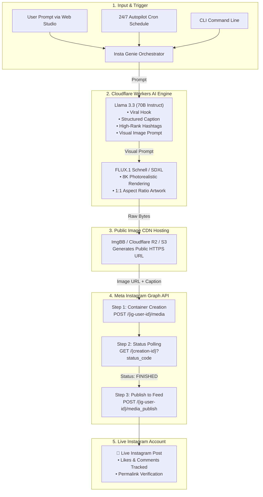

<div align="center">

# ✨ Insta Genie Agent
### Autonomous AI Instagram Creation & Direct Publishing Engine

[](https://opensource.org/licenses/MIT)
[](https://python.org)
[](https://fastapi.tiangolo.com)
[](https://developers.cloudflare.com/workers-ai/)
[](https://developers.facebook.com/docs/instagram-api)
[](https://docker.com)

<p align="center">
  <b>An end-to-end autonomous social media growth agent that ideates high-converting captions, generates photorealistic 8K visuals via Cloudflare Workers AI, and publishes directly to verified Instagram Business/Creator accounts using the Meta Graph API.</b>
</p>

</div>

---

## 🌟 Key Capabilities

- 🤖 **Cloudflare Workers AI Integration**:
  - **Text Generation**: Utilizes `@cf/meta/llama-3.3-70b-instruct-fp8-fast` to generate viral hooks, structured story captions, call-to-actions, and niche hashtag sets.
  - **Image Generation**: Uses `@cf/black-forest-labs/flux-1-schnell` and `@cf/bytedance/stable-diffusion-xl-lightning` for prompt-engineered 1:1 Instagram visuals.
- 📸 **Meta Graph API Direct Publishing**:
  - Complete 3-step publishing workflow: Media Container Creation (`POST /{ig-user-id}/media`), Status Polling (`GET /{creation-id}?fields=status_code`), and Final Feed Publishing (`POST /{ig-user-id}/media_publish`).
- ⚡ **Dual Backend Architecture**:
  - **Python Backend**: High-performance FastAPI service with background job schedulers (`APScheduler`), Rich CLI, and interactive Web Dashboard.
  - **Node.js / Cloudflare Worker**: Serverless edge worker ready to deploy directly to Cloudflare edge with native `@cloudflare/ai` bindings and cron triggers.
- 🎨 **Glassmorphic Web Studio**:
  - Real-time Instagram post phone mockup preview, live hashtag chip copy, 1-click autonomous publishing, and interactive execution telemetry logs.
- ⏰ **24/7 Autopilot Scheduler**:
  - Set custom intervals (e.g. every 6 hours) to automatically select trending topics, generate posts, and maintain account growth autonomously.
- 🛡️ **Zero-Failure Dry Run Mode**:
  - Clone and test the complete pipeline instantly with built-in mock responses without requiring live API keys upfront.

---

## 🏗️ System Architecture



---

## 📁 Repository Structure

```
insta-genie/
├── .github/workflows/ci.yml       # GitHub Actions CI pipeline
├── .env.example                   # Environment credentials template
├── Dockerfile                     # Multi-stage production container
├── docker-compose.yml             # Single-command docker launch
├── package.json                   # Root task runner scripts
│
├── python_service/                # 🐍 Python FastAPI & CLI Service
│   ├── requirements.txt           # Python dependencies
│   ├── pyproject.toml             # Package definitions
│   ├── main.py                    # CLI & server entrypoint
│   ├── config.py                  # Pydantic environment configuration
│   ├── core/
│   │   ├── cloudflare_ai.py       # Workers AI client (Llama 3.3 + FLUX.1)
│   │   ├── instagram_api.py       # Meta Graph API publisher
│   │   ├── image_uploader.py      # Public CDN hosting (ImgBB, S3, R2)
│   │   ├── pipeline.py            # End-to-end agent orchestrator
│   │   └── scheduler.py           # Recurrent automated posting agent
│   ├── web/
│   │   ├── app.py                 # FastAPI REST routes
│   │   └── static/                # Modern Glassmorphic Web Dashboard
│   │       ├── index.html         # Live Instagram simulator UI
│   │       ├── styles.css         # Dark theme styles & glassmorphism
│   │       └── app.js             # Client-side agent controller
│   └── tests/
│       └── test_pipeline.py       # Unit tests with mock fixtures
│
└── node_worker/                   # ⚡ Cloudflare Worker & Node.js Edge Service
    ├── package.json               # Node dependencies
    ├── wrangler.jsonc             # Cloudflare Worker configuration & Cron
    ├── tsconfig.json              # TypeScript configuration
    └── src/
        ├── index.ts               # Worker fetch & cron entrypoint
        ├── cloudflare_ai.ts       # Native Workers AI binding client
        ├── instagram.ts           # Meta Graph API client
        └── pipeline.ts            # Generation & posting pipeline
```

---

## 🚀 Quickstart Guide

### 1. Clone Repository & Setup Environment

```bash
git clone https://github.com/your-username/insta-genie.git
cd insta-genie

# Copy environment template
cp .env.example .env
```

### 2. Configure Credentials (`.env`)

Edit `.env` with your API keys (or leave default for instant **DRY_RUN** test mode):

```ini
# Safe testing mode (set to false for live publishing)
DRY_RUN=false

# Cloudflare Workers AI
CLOUDFLARE_ACCOUNT_ID=your_account_id
CLOUDFLARE_API_TOKEN=your_workers_ai_token

# Meta Instagram Graph API
INSTAGRAM_ACCOUNT_ID=your_instagram_business_id
INSTAGRAM_ACCESS_TOKEN=your_long_lived_meta_token

# Public Image Hosting (Free key from https://api.imgbb.com/)
IMAGE_HOST_PROVIDER=imgbb
IMGBB_API_KEY=your_imgbb_api_key
```

---

### 3. Running with Python & Web Dashboard

```bash
# Create and activate virtual environment
python -m venv .venv
source .venv/bin/activate   # On Windows: .venv\Scripts\activate

# Install dependencies
pip install -r python_service/requirements.txt

# Launch Web Dashboard
python -m python_service.main --serve
```
Open **[http://localhost:8000](http://localhost:8000)** in your browser.

#### Using the CLI:
```bash
# Run 1-click immediate generation and posting
python -m python_service.main --run-now --topic "Autonomous AI Agents in 2026"

# Run in safe test mode
python -m python_service.main --run-now --dry-run
```

---

### 4. Running with Docker

```bash
docker-compose up --build
```

---

### 5. Running with Cloudflare Worker (Node.js / Edge)

```bash
cd node_worker
npm install

# Start local worker emulator
npm run dev

# Deploy to Cloudflare global network
npm run deploy
```

---

## 🔑 Meta Graph API Setup Guide

1. **Convert Instagram to Business/Creator**:
   - In the Instagram mobile app, navigate to **Settings > Account > Switch to Professional Account**.
2. **Link to Facebook Page**:
   - Connect your Instagram Business account to a Facebook Page you manage.
3. **Create Meta App**:
   - Go to [Meta for Developers](https://developers.facebook.com/) and create an app with type **Business**.
   - Add the **Instagram Graph API** product.
4. **Required Permissions**:
   - `instagram_basic`
   - `instagram_content_publish`
   - `pages_read_engagement`
   - `pages_show_list`
5. **Generate Long-Lived Token**:
   - Use the **Graph API Explorer** to generate a User Access Token, then exchange it for a 60-day long-lived token via:
   ```
   GET https://graph.facebook.com/v20.0/oauth/access_token?grant_type=fb_exchange_token&client_id={app-id}&client_secret={app-secret}&fb_exchange_token={short-lived-token}
   ```
6. **Find your Instagram Account ID**:
   ```
   GET https://graph.facebook.com/v20.0/me/accounts?access_token={token}
   GET https://graph.facebook.com/v20.0/{page-id}?fields=instagram_business_account&access_token={token}
   ```

---

## 🧪 Testing

Run the automated test suite with pytest:

```bash
pytest python_service/tests -v
```

---

## 📄 License

This project is licensed under the [MIT License](LICENSE).
